# ARSIP DIGITAL & PORTAL SATU DATA BAPPERIDA
**Panduan Pengguna Sistem Terpadu Perencanaan Pembangunan & Portal Satu Data Indonesia**  
BAPPERIDA Kabupaten Sumba Barat  
URL Produksi: [https://arsipdigital.mindcloud.my.id/](https://arsipdigital.mindcloud.my.id/)

---

## Daftar Isi

### Bagian I: Modul Arsip Digital & Perencanaan
1. [Dashboard Arsip Digital](#1-dashboard-arsip-digital)
2. [Pustaka Dokumen & Filter](#2-pustaka-dokumen--filter)
3. [Detail & Persetujuan Dokumen](#3-detail--persetujuan-dokumen)
4. [Upload Dokumen](#4-upload-dokumen)
5. [Kertas Kerja & Pohon Cascading](#5-kertas-kerja--pohon-cascading)
6. [Screening RKA & Standar Harga (SSH/SBU)](#6-screening-rka--standar-harga-sshsbu)
7. [Kategori Dokumen](#7-kategori-dokumen)
8. [Sektor Pembangunan](#8-sektor-pembangunan)
9. [Audit Trail](#9-audit-trail)

### Bagian II: Modul Satu Data Indonesia (SDI)
10. [Dashboard Satu Data](#10-dashboard-satu-data)
11. [Dataset Sektoral Satu Data](#11-dataset-sektoral-satu-data)
12. [Indikator Kinerja Makro (IKU, IKD, IKK)](#12-indikator-kinerja-makro-iku-ikd-ikk)
13. [Verifikasi Dataset (Verval Walidata)](#13-verifikasi-dataset-verval-walidata)
14. [Capaian SPM (Standar Pelayanan Minimal)](#14-capaian-spm-standar-pelayanan-minimal)
15. [Master Satu Data & Konfigurasi Fondasi](#15-master-satu-data--konfigurasi-fondasi)
16. [Kelola Konten & Publikasi Informasi](#16-kelola-konten--publikasi-informasi)
17. [Monitoring Sistem & Integrasi SDPDN](#17-monitoring-sistem--integrasi-sdpdn)
18. [Portal Publik Satu Data](#18-portal-publik-satu-data)

### Bagian III: Umum, Administrasi & Akun
19. [Login & Autentikasi Pengguna](#19-login--autentikasi-pengguna)
20. [Pencarian Dokumen](#20-pencarian-dokumen)
21. [Manajemen Pengguna (Admin)](#21-manajemen-pengguna-admin)
22. [Tips & Pemecahan Masalah (Troubleshooting)](#22-tips--pemecahan-masalah-troubleshooting)

---

# BAGIAN I: MODUL ARSIP DIGITAL & PERENCANAAN

## 1. Dashboard Arsip Digital

Halaman utama setelah login untuk modul kearsipan dan perencanaan internal BAPPERIDA Kabupaten Sumba Barat.

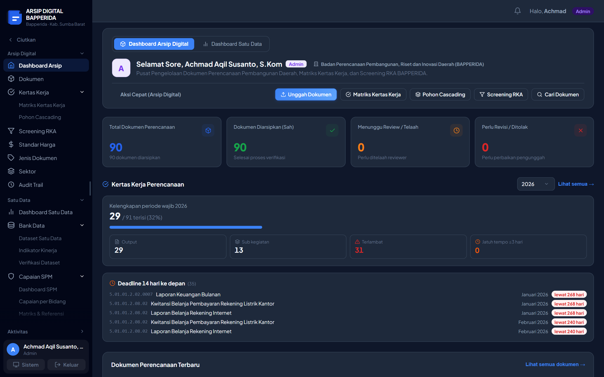

Menampilkan:
- **Total Dokumen** — Jumlah seluruh berkas dalam repositori kearsipan daerah.
- **Dokumen Perlu Review** — Dokumen yang menunggu telaah dan persetujuan pejabat berwenang (Reviewer/Admin).
- **Dokumen Diarsipkan** — Dokumen yang telah disahkan secara final dan berkekuatan hukum.
- **Grafik Distribusi** — Komposisi berkas per jenis naskah perencanaan dan per sektor pembangunan.
- **Dokumen Terbaru** — 5 dokumen terakhir yang diunggah beserta uploader, bidang, status, dan tombol pintasan *"Lihat →"*.

---

## 2. Pustaka Dokumen & Filter

Katalog seluruh dokumen perencanaan pembangunan daerah dengan filter terpadu untuk memudahkan penemuan berkas.


### Filter Pencarian:
1. **Filter Jenis** — RPJMD, Renstra, Renja, RKA, DPA, LAKIP, Kajian Ekonomi, dll.
2. **Filter Sektor** — Pertanian & Pangan, Pariwisata, UMKM, Infrastruktur, Kesehatan, dll.
3. **Filter Tahun** — Pilih tahun dokumen (2020 s/d 2027).
4. **Filter Status** — Menunggu Review, Menunggu Persetujuan, Diarsipkan, Ditolak.

---

## 3. Detail & Persetujuan Dokumen

Halaman detail menampilkan pratinjau visual naskah dinas, kelengkapan metadata, riwayat versi (*versioning*), dan alur persetujuan bertingkat.

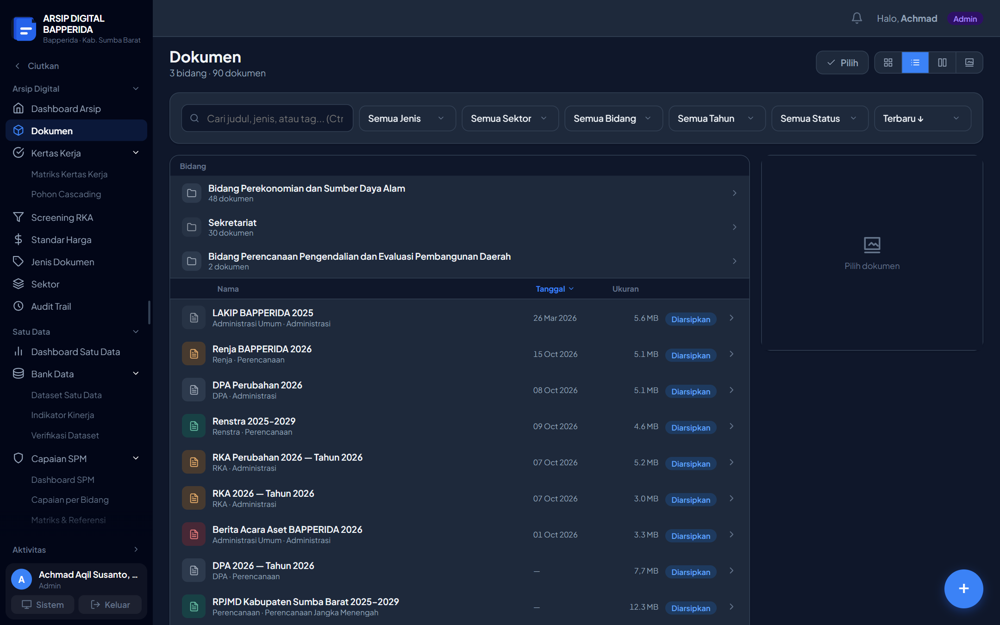

### Alur Persetujuan Dokumen:
```
Staf Unggah → Menunggu Review → Direview Kabid → Menunggu Persetujuan → Kepala / Admin Setujui → Diarsipkan
                                                                          ↘ Ditolak (Perlu Revisi)
```

| Status Dokumen | Staf Perencana | Reviewer / Kabid | Admin / Kepala |
|---|:---:|:---:|:---:|
| **Menunggu Review** | — | **Setujui / Tolak** | **Setujui / Tolak** |
| **Menunggu Persetujuan** | — | — | **Setujui Final / Tolak** |
| **Diarsipkan** | Unduh / Bagikan | Unduh / Bagikan | Unduh / Kelola Versi |
| **Ditolak** | Upload Ulang Revisi | Beri Catatan Revisi | Beri Catatan Revisi |

---

## 4. Upload Dokumen

Unggah dokumen perencanaan baru ke repositori digital berbasis penyimpanan cloud Google Drive dan database PostgreSQL.

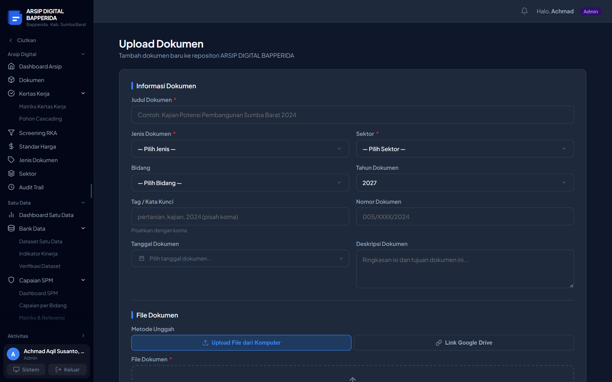

1. Klik menu **Upload Dokumen** di sidebar atau tombol **+** di Pustaka Dokumen.
2. Isi formulir metadata: Judul Dokumen, Jenis Dokumen, Sektor Pembangunan, Bidang BAPPERIDA, dan Tahun Dokumen.
3. Pilih metode unggah: **File Komputer** (PDF, DOCX, XLSX, JPG, PNG) atau **Tautan Google Drive**.
4. Klik **Upload & Kirim untuk Review**.

---

## 5. Kertas Kerja & Pohon Cascading

Modul asistensi penelaahan keterkaitan antara Tujuan, Sasaran, Program, Kegiatan, hingga Subkegiatan perencanaan pembangunan.

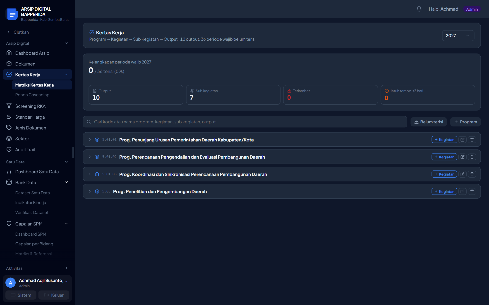

- **Matriks Kertas Kerja**: Penelaahan keselarasan indikator kinerja kuantitatif, satuan, target, dan pagu indikatif belanja.
- **Pohon Cascading**: Visualisasi diagram hierarki kinerja dari Sasaran Strategis Daerah → Program Prioritas → Kegiatan Operasional.
- **Status Hasil Telaah**: Menandai subkegiatan yang *Sesuai*, *Perlu Penyesuaian*, atau *Belum Selaras*.

---

## 6. Screening RKA & Standar Harga (SSH/SBU)

Modul penelaahan kepatuhan rincian belanja RKA OPD terhadap master standar harga satuan daerah Kabupaten Sumba Barat.

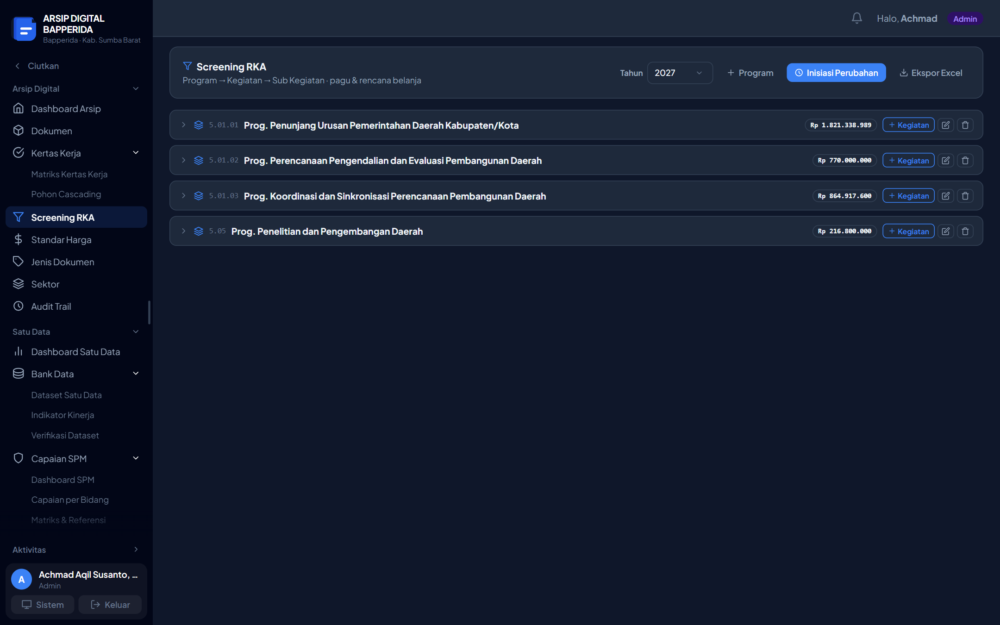

- Unggah berkas RKA hasil ekspor SIPD dalam format file Excel atau CSV.
- Sistem memadankan uraian rekening belanja dengan master data **SSH, SBU, ASB, dan HSPK** daerah secara otomatis.
- Menghasilkan tabel deteksi selisih harga untuk komponen belanja yang melebihi batas standar atau belum terdaftar.

---

## 7. Kategori Dokumen

Khusus **Administrator** sistem untuk mengelola jenis atau kategori dokumen perencanaan.

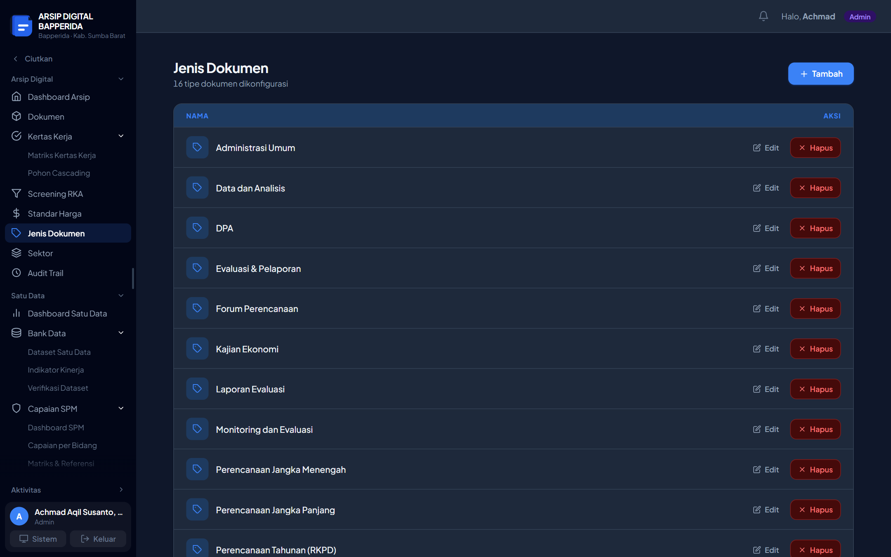

- **Tambah Kategori**: Menambahkan kategori jenis dokumen baru.
- **Edit Kategori**: Mengubah penamaan jenis dokumen yang telah ada.
- **Hapus Kategori**: Menghapus kategori yang tidak lagi digunakan.

---

## 8. Sektor Pembangunan

Khusus **Administrator** sistem untuk mengelola klasifikasi sektor ekonomi dan pembangunan daerah.

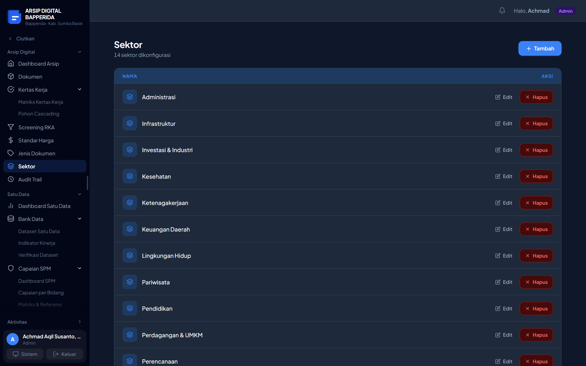

- Mengelola sektor-sektor strategis pembangunan daerah.
- Menjadi parameter filter pada Pustaka Dokumen dan visualisasi grafik dashboard kearsipan.

---

## 9. Audit Trail

Mencatat rekam jejak aktivitas digital pengguna secara otomatis dan permanen demi menjamin akuntabilitas kearsipan.

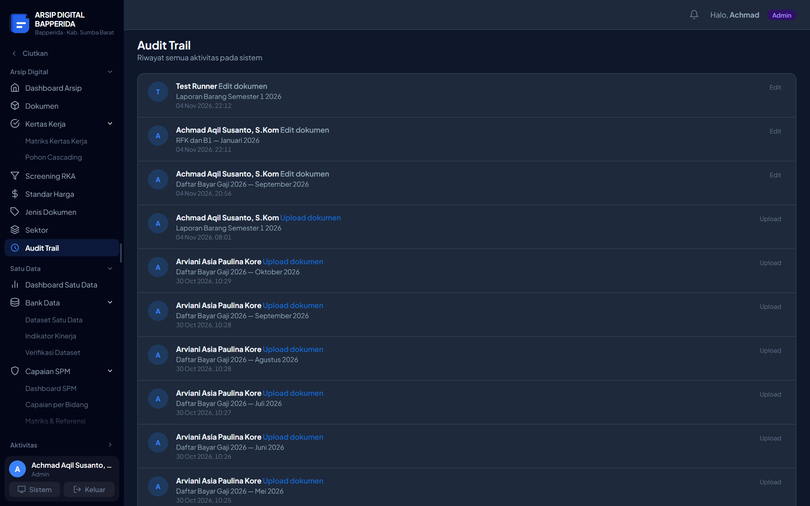

- Mencatat: User & NIP, Aksi (Upload, Review, Setuju, Tolak, Unduh), Dokumen Terkait, dan Waktu presisi (*timestamp*).

---

# BAGIAN II: MODUL SATU DATA INDONESIA (SDI)

## 10. Dashboard Satu Data

Pusat pemantauan ekosistem data pembangunan Kabupaten Sumba Barat sesuai kaidah Perpres No. 39 Tahun 2019 tentang Satu Data Indonesia.


- **4 Kartu Statistik Utama**: Total Dataset Aktif, Dataset Terverifikasi (Lolos Verval), Menunggu Verifikasi, dan Draf.
- **Tingkat Kepatuhan Produsen Data**: Rekapitulasi keaktifan pembaruan data berkala dari seluruh OPD se-Kabupaten Sumba Barat.
- **Sebaran per Bidang Urusan**: Grafik komposisi ketersediaan data pada urusan Pendidikan, Kesehatan, Pertanian, PUPR, Pariwisata, dll.
- **Daftar Pemutakhiran Terkini**: Log pengajuan data statistik terbaru dari operator dinas teknis.

---

## 11. Dataset Sektoral Satu Data

Pengelolaan data statistik sektoral daerah berbasis tabel tabular terstandarisasi mengacu pada prinsip Satu Data Indonesia.

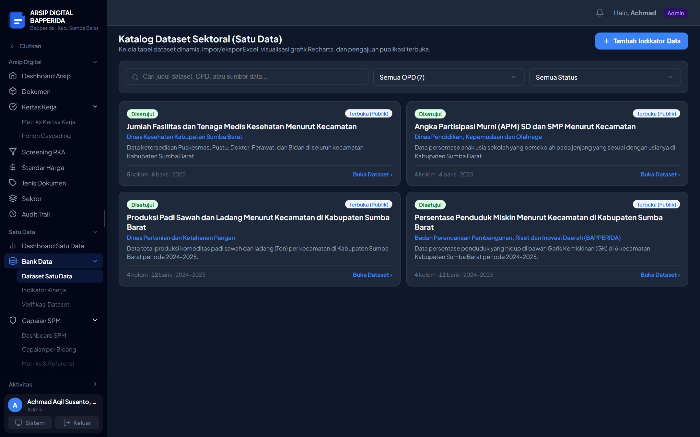

### Alur Pengelolaan Dataset:
1. Klik tombol **Tambah Dataset** untuk menyusun data baru.
2. Lengkapi metadata standar: Judul Dataset, Urusan & Bidang Urusan, Topik/Sub-Topik, Produsen Data (OPD), Periode, dan Satuan Baku.
3. Masukkan angka realisasi statistik per tahun/wilayah langsung pada tabel matriks atau gunakan fasilitas **Impor Excel**.
4. Klik **Kirim untuk Verifikasi** agar dataset masuk ke antrean penelaahan Walidata Daerah.

---

## 12. Indikator Kinerja Makro (IKU, IKD, IKK)

Pengelolaan indikator capaian kinerja strategis pembangunan daerah Kabupaten Sumba Barat secara terukur dan berkelanjutan.

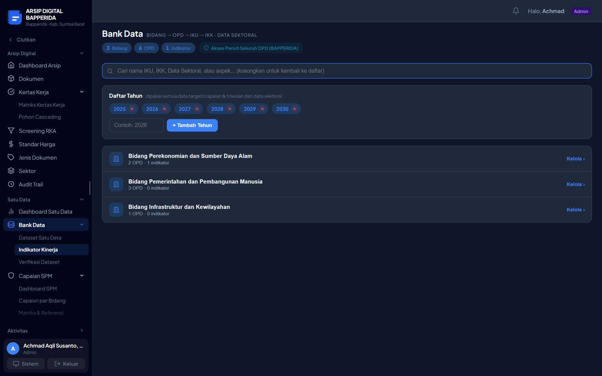

- **IKU (Indikator Kinerja Utama)**: Indikator makro daerah (Pertumbuhan Ekonomi, IPM, Kemiskinan, Gini Ratio).
- **IKD (Indikator Kinerja Daerah)**: Indikator tingkat bidang urusan pemerintahan.
- **IKK (Indikator Kinerja Kunci)**: Indikator operasional OPD sesuai dokumen perencanaan Renstra.
- Menampilkan perbandingan Target vs Realisasi multi-tahun dan grafik tren ketercapaian.

---

## 13. Verifikasi Dataset (Verval Walidata)

Alur penelaahan dan validasi oleh Walidata Daerah (BAPPERIDA / Diskominfo) terhadap data yang diajukan oleh OPD sebelum tayang ke publik.

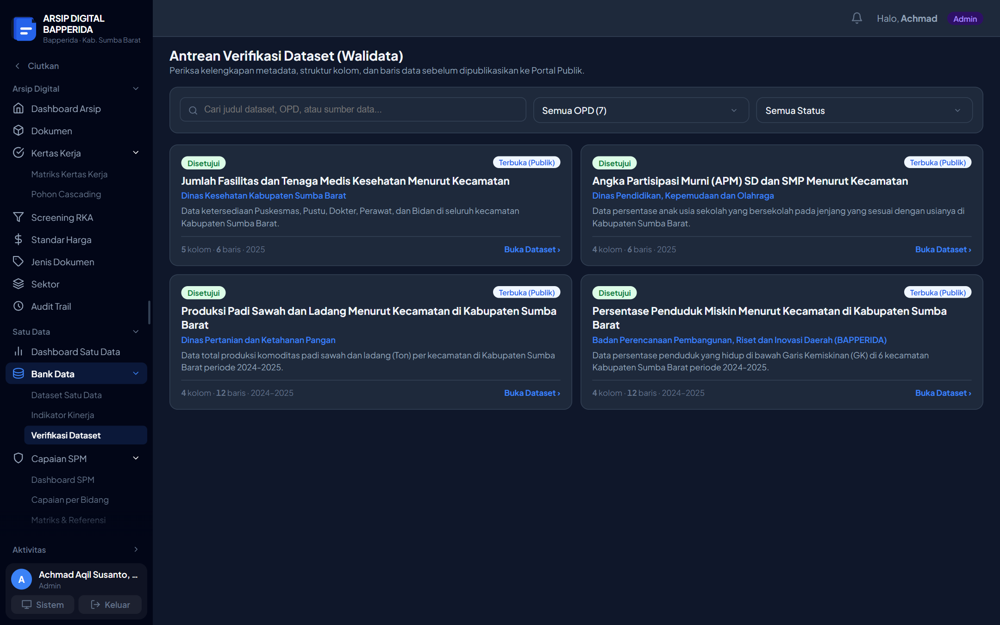

- Walidata memeriksa 4 kaidah Satu Data: Standar Data, Kelengkapan Metadata, Format Interoperabilitas, dan Kesesuaian Kode Referensi.
- **Setujui**: Dataset resmi dipublikasikan ke Portal Publik Satu Data.
- **Kembalikan / Revisi**: Walidata memberikan catatan perbaikan teknis ke operator OPD.

---

## 14. Capaian SPM (Standar Pelayanan Minimal)

Pemantauan pemenuhan hak dasar warga negara pada 6 Urusan Wajib Pelayanan Dasar pemerintah daerah sesuai amanat PP No. 2 Tahun 2018.

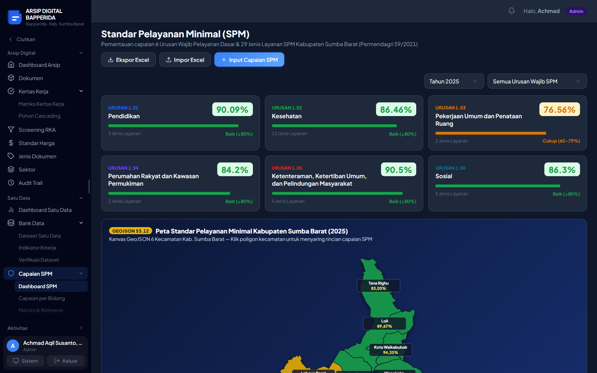

### 6 Urusan Pelayanan Dasar:
1. **Pendidikan**: Akses pendidikan dasar (PAUD, SD, SMP).
2. **Kesehatan**: Pelayanan kesehatan ibu, balita, usia produktif, lansia.
3. **Pekerjaan Umum**: Akses air minum layak dan sanitasi aman.
4. **Perumahan Rakyat**: Rumah layak huni bagi korban bencana/relokasi.
5. **Trantibumlinmas**: Ketenteraman masyarakat dan penanggulangan bencana.
6. **Sosial**: Rehabilitasi penyandang disabilitas dan lansia terlantar.

---

## 15. Master Satu Data & Konfigurasi Fondasi

Pengaturan fondasi data induk Satu Data Kabupaten Sumba Barat (khusus Administrator SDI).

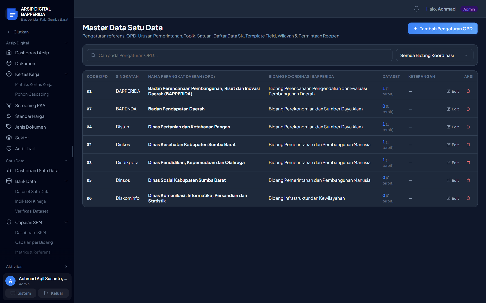

- **Pengaturan OPD**: Master data unit kerja produsen data dan kontak narahubung dinas.
- **Urusan & Bidang Urusan**: Kodifikasi urusan pemerintahan mengacu standar Permendagri 90/2019.
- **Hak Akses Urusan**: Pemetaan urusan apa saja yang boleh diisi oleh masing-masing akun OPD.
- **Daftar Data (SK Bupati)**: Inventarisasi dataset prioritas daerah yang telah ditetapkan secara legal.
- **Permintaan Reopen**: Fasilitas persetujuan bagi OPD yang mengajukan pembukaan kembali data tahun lampau yang terkunci.

---

## 16. Kelola Konten & Publikasi Informasi

Pusat penerbitan informasi publik, artikel analisis data, produk hukum statistik, dan riwayat pembaruan sistem.

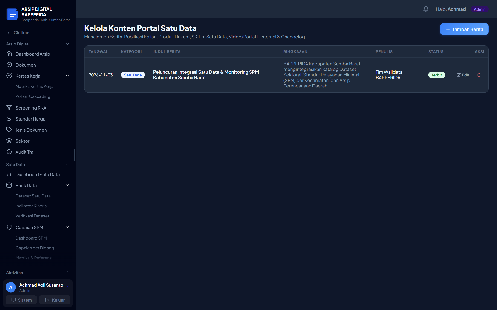

- **Berita & Artikel**: Publikasi artikel analisis statistik pembangunan ekonomi dan kabar kegiatan satu data daerah.
- **Publikasi, SK & Hukum**: Repositori unduhan buku statistik digital (*Sumba Barat dalam Angka*, PDRB) dan SK Bupati Satu Data.
- **Video & Portal Eksternal**: Tautan materi edukasi dan integrasi portal kementerian.
- **Changelog Aplikasi**: Catatan rilis pembaruan fitur sistem untuk transparansi pengguna.

---

## 17. Monitoring Sistem & Integrasi SDPDN

Pemantauan keandalan sistem, trafik pengunjung, integrasi API nasional SDPDN, dan kueri data tingkat lanjut (khusus Administrator).

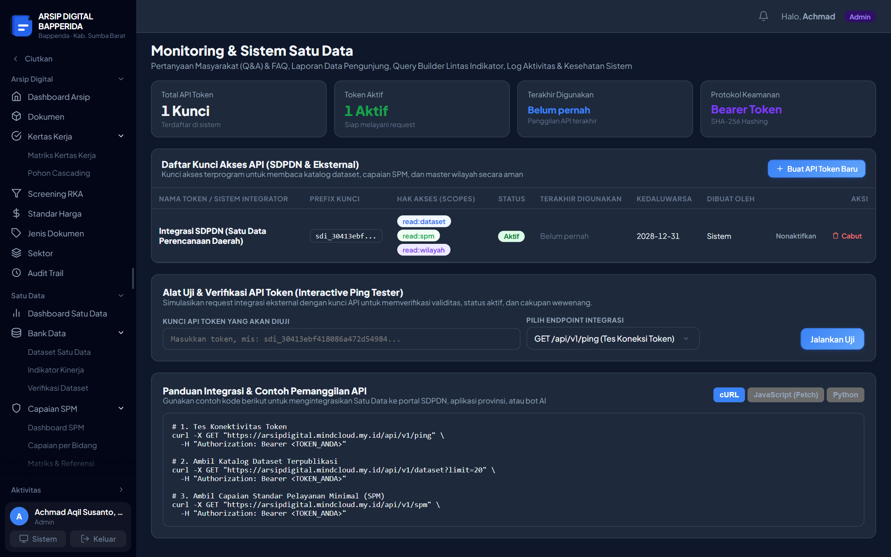

- **Token API SDPDN**: Pengelolaan kredensial interoperabilitas dengan sistem Satu Data Pembangunan Daerah Nasional.
- **Kesehatan & Scheduler**: Pemantauan status operasional server, database PostgreSQL, dan Google Drive storage.
- **Data Pengunjung**: Analisis statistik trafik pengunjung dan dataset yang paling banyak diunduh masyarakat.
- **Query Builder & Ekspor**: Alat pembangun kueri fleksibel untuk menarik laporan data sektoral dalam format CSV atau Excel.

---

## 18. Portal Publik Satu Data

Etalase keterbukaan data pembangunan Kabupaten Sumba Barat yang dapat diakses oleh masyarakat tanpa perlu login.

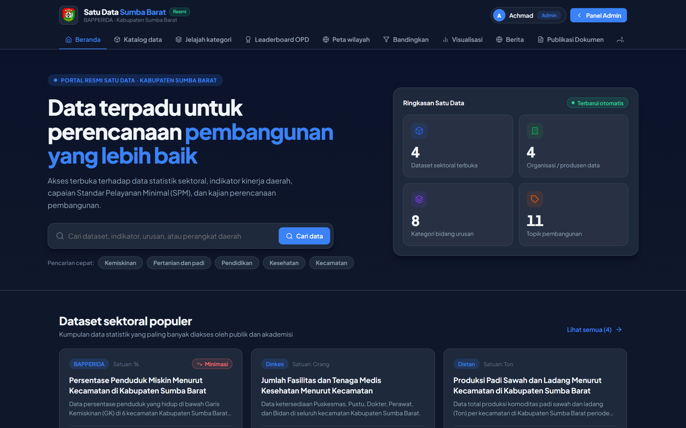

- Katalog dataset sektoral terbuka yang mudah dicari.
- Visualisasi grafik interaktif dan peta spasial sebaran indikator per kecamatan.
- Unduh data terbuka dalam format standar `CSV`, `Excel`, dan `PDF`.

---

# BAGIAN III: UMUM, ADMINISTRASI & AKUN

## 19. Login & Autentikasi Pengguna

Akses masuk sistem terpadu menggunakan Nomor Induk Pegawai (NIP) dan Kata Sandi resmi.

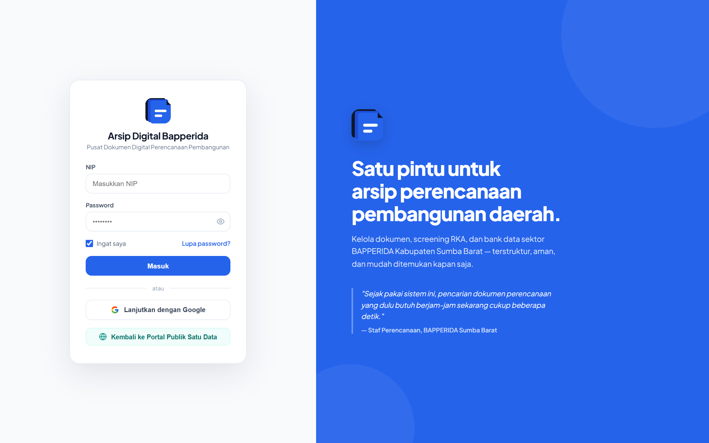

1. Buka URL resmi: `https://arsipdigital.mindcloud.my.id/`.
2. Masukkan **NIP** (18 digit) dan **Password** (default: `BapperidaSB2026`).
3. Klik tombol **Masuk**.
4. Akun internal BAPPERIDA otomatis diarahkan ke Dashboard Arsip, sedangkan akun dinas lain diarahkan ke modul Satu Data.

---

## 20. Pencarian Dokumen

Fitur pencarian teks bebas di seluruh repositori dokumen perencanaan daerah.

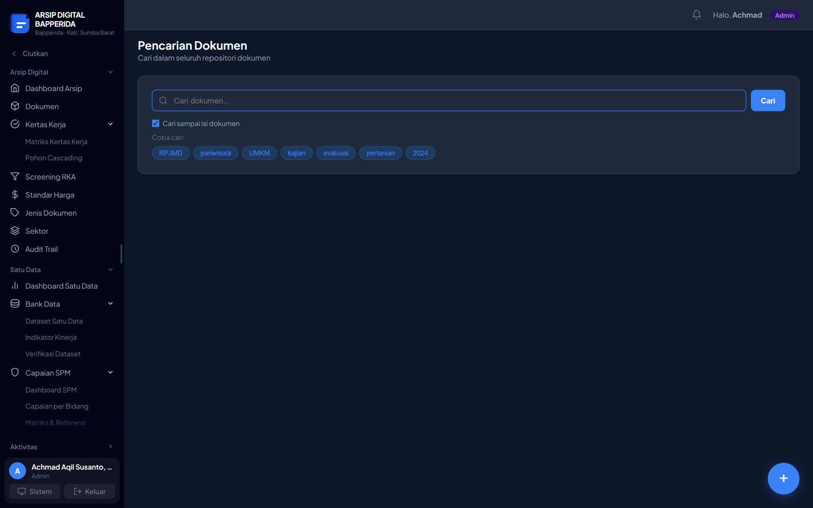

- Ketik kata kunci pada kolom pencarian untuk menampilkan naskah secara seketika (*real-time*).
- Menampilkan judul, jenis, sektor, tahun, bidang, dan status dokumen.

---

## 21. Manajemen Pengguna (Admin)

Fasilitas Administrator untuk mengelola akun pengguna, hak akses peran (*Role Matrix*), dan pembatasan cakupan instansi (*OPD Scoping*).

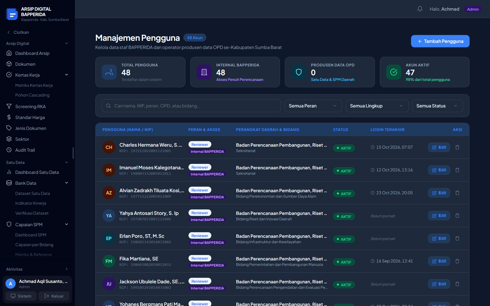

- Daftarkan pegawai dengan NIP, nama lengkap, unit/instansi OPD, peran (Admin, Reviewer, Staf, Walidata, Produsen Data), dan password awal.
- Atur ulang kata sandi pegawai yang mengalami kendala lupa sandi.
- Operator dinas lain otomatis dibatasi hak aksesnya hanya untuk data milik instansinya sendiri (*OPD Scoping*).

---

## 22. Tips & Pemecahan Masalah (Troubleshooting)

Panduan solusi cepat untuk mengatasi kendala operasional yang mungkin ditemui pengguna.

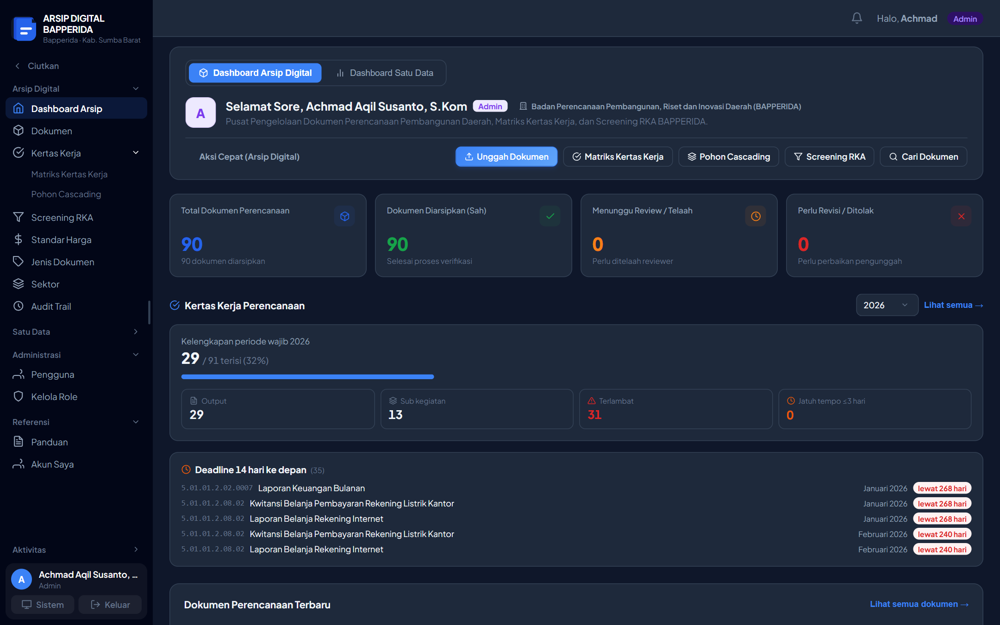

| Kendala Operasional | Kemungkinan Penyebab | Tindakan Penyelesaian |
|---|---|---|
| **Lupa Password** | Salah mengingat kata sandi. | Hubungi Administrator BAPPERIDA untuk melakukan reset password akun Anda. |
| **Gagal Upload Berkas** | Format berkas tidak didukung atau koneksi terputus. | Pastikan berkas berformat `.pdf`, `.docx`, atau `.xlsx` yang valid dan koneksi stabil. |
| **Menu Perencanaan Tidak Muncul** | Terdaftar sebagai akun OPD non-BAPPERIDA. | Pengguna dari OPD lain memang dikhususkan untuk modul Satu Data. Hubungi Admin jika butuh akses arsip internal. |
| **Dokumen Tidak Muncul di Tabel** | Filter aktif menyaring hasil. | Periksa tombol filter jenis, sektor, atau tahun di bilah atas Pustaka Dokumen. |
| **Dataset Belum Tampil di Portal Publik** | Masih menunggu verifikasi Walidata. | Hubungi Tim Walidata BAPPERIDA untuk meninjau antrean verifikasi data Anda. |
| **Halaman Macet / Blank** | Cache peramban lama masih tersimpan. | Lakukan hard refresh (`Ctrl + F5` pada Windows) atau logout lalu login kembali. |
