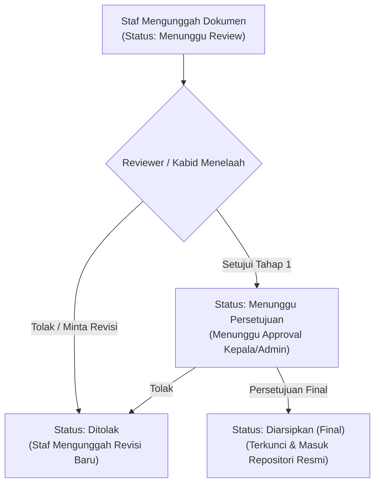

# PANDUAN PENGGUNA ARSIP DIGITAL & SISTEM PERENCANAAN
**BAPPERIDA KABUPATEN SUMBA BARAT**

> Dokumen Panduan Operasional Khusus: **Pilar 1 — Arsip Digital & Perencanaan Daerah**  
> Sistem: `peta-ekonomi` / Portal Arsip Digital BAPPERIDA  
> URL Produksi: [https://arsipdigital.mindcloud.my.id/#dashboard](https://arsipdigital.mindcloud.my.id/#dashboard)  
> Pemutakhiran Terakhir: November 2026

---

## Daftar Isi

1. [Gambaran Umum & Hak Akses](#1-gambaran-umum--hak-akses)
2. [Login & Autentikasi](#2-login--autentikasi)
3. [Dashboard Arsip Digital](#3-dashboard-arsip-digital)
4. [Pustaka Dokumen (Pencarian, Filter & Mode Tampilan)](#4-pustaka-dokumen)
5. [Detail Dokumen & Pratinjau Universal](#5-detail-dokumen--pratinjau-universal)
6. [Alur Unggah Dokumen (Single, Multi-Upload & Google Drive)](#6-alur-unggah-dokumen)
7. [Siklus Verifikasi & Persetujuan Berjenjang](#7-siklus-verifikasi--persetujuan-berjenjang)
8. [Modul Kertas Kerja & Pohon Cascading](#8-modul-kertas-kerja--pohon-cascading)
9. [Screening RKA & Penelaahan Belanja](#9-screening-rka--penelaahan-belanja)
10. [Master Standar Harga (SSH, SBU, ASB, HSPK)](#10-master-standar-harga)
11. [Master Kategori Dokumen & Sektor](#11-master-kategori-dokumen--sektor)
12. [Audit Trail & Riwayat Aktivitas](#12-audit-trail--riwayat-aktivitas)
13. [Berbagi Dokumen & Tautan Publik (QR Code)](#13-berbagi-dokumen--tautan-publik)

---

## 1. Gambaran Umum & Hak Akses

Modul **Arsip Digital & Perencanaan** difokuskan sebagai workstation internal bagi **BAPPERIDA (Badan Perencanaan Pembangunan, Riset dan Inovasi Daerah) Kabupaten Sumba Barat**. Modul ini mengintegrasikan seluruh tahapan hulu perencanaan:
- Digitalisasi dan repositori dokumen perencanaan (RPJMD, Renstra, Renja, RKA, DPA, LAKIP, Kajian).
- Kertas kerja penelaahan program/kegiatan/subkegiatan serta visualisasi pohon cascading kinerja.
- Validasi kepatuhan RKA terhadap standar harga daerah (SSH/SBU/ASB/HSPK) sebelum penetapan.

### Matriks Peran Pengguna (Role Matrix)

| Role | Ruang Lingkup & Wewenang | Akses Menu |
|---|---|---|
| **Admin** | Penguasa penuh sistem: persetujuan akhir dokumen, pengelolaan master standar harga, manajemen kategori/sektor, manajemen user & role, audit trail. | Semua menu Arsip Digital, Satu Data, dan Administrasi |
| **Reviewer / Kabid** | Melakukan telaah, catatan revisi, serta menyetujui/menolak usulan dokumen pada tahap pertama (Menunggu Review). | Dashboard Arsip, Dokumen, Detail & Approval, Kertas Kerja, Screening RKA, Unggah |
| **Staf Perencana** | Mengunggah dokumen baru, memperbarui draft revisi, mengisi matriks kertas kerja, dan meninjau pustaka dokumen. | Dashboard Arsip, Dokumen (view/upload), Kertas Kerja, Screening RKA |
| **Pengguna OPD Lain** | Terbatas hanya melihat dokumen yang telah berstatus *Diarsipkan* dan bertanda publik, atau berkas yang didelegasikan ke unit kerja terkait. | Portal Publik & Dokumen Terkait |

---

## 2. Login & Autentikasi

1. Buka URL: [https://arsipdigital.mindcloud.my.id/](https://arsipdigital.mindcloud.my.id/)
2. Masukkan **NIP** (18 digit nomor induk pegawai) atau klik nama akun pada daftar cepat jika tersedia.
3. Masukkan **Kata Sandi** (Password).
4. Klik tombol **Masuk**.
5. Sistem akan memverifikasi peran dan mengarahkan pengguna ke **Dashboard Arsip** (bagi staf internal BAPPERIDA) atau **Dashboard Satu Data** (bagi operator OPD).

> **Catatan Keamanan**: Penggantian kata sandi dapat dilakukan mandiri melalui menu **Referensi → Akun Saya**, atau melalui bantuan Administrator jika terjadi lupa sandi.

---

## 3. Dashboard Arsip Digital

Halaman Dashboard menyajikan metrik ringkas kinerja arsip dan perencanaan:
1. **Kartu Statistik Utama**:
   - **Total Dokumen**: Jumlah seluruh berkas dalam repositori.
   - **Diarsipkan (Final)**: Dokumen yang telah disetujui penuh dan berkekuatan hukum.
   - **Menunggu Review / Persetujuan**: Dokumen dalam antrean verifikasi berjenjang.
   - **Ditolak / Perlu Perbaikan**: Dokumen yang dikembalikan ke pengunggah untuk diperbaiki.
2. **Grafik Distribusi**:
   - Grafik batang dokumen berdasarkan **Jenis Dokumen** (RPJMD, Renja, RKA, dsb).
   - Grafik batang dokumen berdasarkan **Sektor Pembangunan** (Pertanian, Pariwisata, Infrastruktur, Pendidikan, dsb).
3. **Dokumen Perencanaan Terbaru**:
   - Daftar 5 dokumen terakhir yang masuk ke sistem beserta uploader, bidang, status, dan tombol pintasan *"Lihat →"*.

---

## 4. Pustaka Dokumen

Akses menu **Arsip Digital → Dokumen** (`#dokumen`) untuk mengelola seluruh dokumen:

### A. Fitur Filter Cepat
- **Filter Jenis Dokumen**: RPJMD, Renstra, Renja, RKA, DPA, LAKIP, Kajian Ekonomi, Laporan Evaluasi, Notulen Rapat, dll.
- **Filter Sektor**: Perencanaan, Pertanian & Pangan, UMKM, Pariwisata, Infrastruktur, Kesehatan, Pendidikan, dll.
- **Filter Bidang Kerja BAPPERIDA**: Sekretariat, PPEPD, Perekonomian & SDA, PMM, Riset & Inovasi.
- **Filter Tahun**: Pilihan tahun dokumen aktif (2020 s/d 2027).
- **Filter Status**: Menunggu Review, Menunggu Persetujuan, Diarsipkan, Ditolak.

### B. Mode Tampilan Pustaka
Pengguna dapat beralih tampilan di pojok kanan atas:
1. **Mode Tabel / List**: Menyajikan informasi padat berupa nama, bidang, tanggal, ukuran, dan status dalam bentuk baris.
2. **Mode Grid / Kolom**: Kartu visual dengan informasi metadata ringkas dan thumbnail.
3. **Mode Galeri (Gallery View)**: Tampilan visual kartu besar dengan cuplikan visual halaman muka dokumen.

---

## 5. Detail Dokumen & Pratinjau Universal

Klik tombol **Buka / Detail** pada salah satu baris dokumen untuk masuk ke halaman detail (`#dokumen/:id`):

1. **Pratinjau Universal (Universal Viewer)**:
   - Preview interaktif berkas PDF langsung di dalam peramban (didukung PDF.js dan Google Drive Embed).
   - Opsi *Buka di Tab Baru* jika pratinjau browser dibatasi hak akses Google Workspace.
2. **Metadata Dokumen**:
   - Jenis Dokumen, Tipe Berkas, Sektor, Bidang Kerja, Tahun Anggaran.
   - Nomor Surat/Dokumen Resmi, Tanggal Dokumen, Versi Berkas, Ukuran File, Jumlah Halaman.
   - Pengunggah, Penelaah (Reviewer), serta Waktu Unggah.
3. **Riwayat Versi (Versioning)**:
   - Pelacakan revisi (v1, v2, v3...).
   - Pengguna dapat mengunggah revisi baru tanpa menghapus jejak versi terdahulu.
4. **Riwayat Status**:
   - Jejak lengkap timestamp mulai dari *Diunggah* → *Di-review* → *Disetujui* / *Ditolak*.

---

## 6. Alur Unggah Dokumen

Akses menu **Upload Dokumen** (`#upload`) atau klik tombol `+` di halaman Dokumen:

### Formulir Metadata:
- **Judul Dokumen** *(Wajib)*: Nama lengkap dokumen (contoh: *Renja BAPPERIDA Tahun 2026*).
- **Jenis Dokumen** *(Wajib)*: Pilih kategori dokumen perencanaan.
- **Sektor Pembangunan** *(Wajib)*: Tentukan sektor terkait.
- **Bidang BAPPERIDA**: Pilih bidang pengampu (Sekretariat / Bidang Teknis).
- **Tahun Dokumen**: Tahun anggaran berlaku.
- **Nomor Dokumen & Tanggal**: Nomor registrasi naskah dinas dan tanggal pengesahan.
- **Tag / Kata Kunci**: Label pencarian (pisahkan dengan koma).
- **Deskripsi / Abstrak**: Catatan ringkas isi dokumen.

### Pilihan Metode Unggah:
1. **Upload Berkas Lokal**:
   - Mendukung format: `.pdf`, `.docx`, `.xlsx`, `.jpg`, `.png`, `.webp`.
   - Mendukung **Multi-Upload** (bisa memilih banyak file sekaligus) dan **Drag-and-Drop**.
   - Sistem melakukan verifikasi *magic bytes* untuk memastikan integritas berkas.
2. **Tautan Google Drive**:
   - Masukkan URL berkas atau folder Google Drive.
   - Berkas otomatis disinkronkan via Google Apps Script BAPPERIDA.

Klik **Upload & Kirim untuk Review**. Dokumen akan masuk ke status `Menunggu Review`.

---

## 7. Siklus Verifikasi & Persetujuan Berjenjang

### Panduan Aksi Tombol:
- **Tombol Setujui (Warna Hijau)**: Meloloskan dokumen ke tingkat berikutnya.
- **Tombol Tolak (Warna Merah)**: Membuka dialog alasan penolakan. Wajib menuliskan catatan revisi agar staf penanggung jawab tahu hal apa yang harus diperbaiki.
- **Tombol Perbarui Berkas (Revisi)**: Mengunggah berkas pengganti yang secara otomatis menaikkan nomor versi dokumen.

---

## 8. Modul Kertas Kerja & Pohon Cascading

Menu **Arsip Digital → Kertas Kerja** (`#kertas-kerja`) mendukung perencanaan berorientasi hasil:

### A. Matriks Kertas Kerja
- Penelaahan keselarasan antara Tujuan, Sasaran, Program, Kegiatan, dan Subkegiatan.
- Pengecekan konsistensi indikator, target kinerja kuantitatif, dan pagu indikatif.
- Status telaah checklist: *Sesuai*, *Perlu Pembahasan*, atau *Belum Selaras*.

### B. Pohon Cascading (Cascading Tree)
- Visualisasi struktur pohon hierarki kinerja:
  $$\text{Tujuan Daerah} \longrightarrow \text{Sasaran Strategis} \longrightarrow \text{Program Prioritas} \longrightarrow \text{Kegiatan} \longrightarrow \text{Sub-Kegiatan}$$
- Menjamin setiap alokasi anggaran belanja memiliki cantolan kinerja yang terukur.

---

## 9. Screening RKA & Penelaahan Belanja

Menu **Arsip Digital → Screening RKA** (`#screening`) adalah instrumen pengawasan belanja:

1. **Unggah File RKA**: Impor berkas RKA hasil ekspor SIPD (format Excel/CSV).
2. **Matching Otomatis Standar Harga**:
   - Sistem memadankan setiap uraian rekening belanja dengan database **SSH / SBU / ASB / HSPK**.
3. **Analisis Selisih & Efisiensi**:
   - Sistem mendeteksi komponen biaya yang melebihi batas atas standar harga daerah.
   - Menghasilkan rekomendasi koreksi pagu sebelum RKA disahkan menjadi DPA.

---

## 10. Master Standar Harga

Menu **Arsip Digital → Standar Harga** (`#standar-harga`) *(Khusus Administrator)*:
- Mengelola referensi Standar Satuan Harga (SSH), Standar Biaya Umum (SBU), Analisis Standar Belanja (ASB), dan Harga Satuan Pokok Kegiatan (HSPK) Kabupaten Sumba Barat.
- Mendukung pencarian instan komponen barang/jasa, kode barang, spesifikasi, satuan, dan batas harga maksimal.
- Fasilitas impor massal data harga standar dari dokumen Peraturan Bupati terbaru.

---

## 11. Master Kategori Dokumen & Sektor

1. **Jenis Dokumen** (`#kategori-dokumen`):
   - Tambah, edit, atau nonaktifkan jenis dokumen (misal: penambahan format Laporan Triwulan, Evaluasi RKPD).
2. **Sektor Pembangunan** (`#sektor`):
   - Pengelompokan urusan pembangunan daerah untuk memudahkan filter statistik pada dashboard.

---

## 12. Audit Trail & Riwayat Aktivitas

Menu **Arsip Digital → Audit Trail** (`#audit`) *(Khusus Administrator)*:
- Mencatat seluruh rekam jejak digital secara permanen (immutability).
- Detail yang dicatat:
  * Nama Pengguna & NIP.
  * Jenis Aksi: `Upload Berkas`, `Review Disetujui`, `Dokumen Ditolak`, `Unduh Berkas`, `Hapus Versi`.
  * Judul Dokumen & ID Berkas.
  * Waktu Presisi (Timestamp) kejadian.

---

## 13. Berbagi Dokumen & Tautan Publik

Setiap dokumen yang telah berstatus **Diarsipkan** dapat dibagikan:
- **Tautan Publik Aman**: Hasilkan shortlink khusus untuk referensi antar-OPD atau stakeholder.
- **QR Code Terintegrasi**: Sistem dapat menghasilkan barcode QR yang dapat ditempel pada lembar pengesahan fisik untuk validasi keaslian digital arsip.

