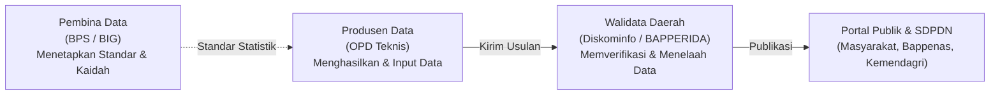
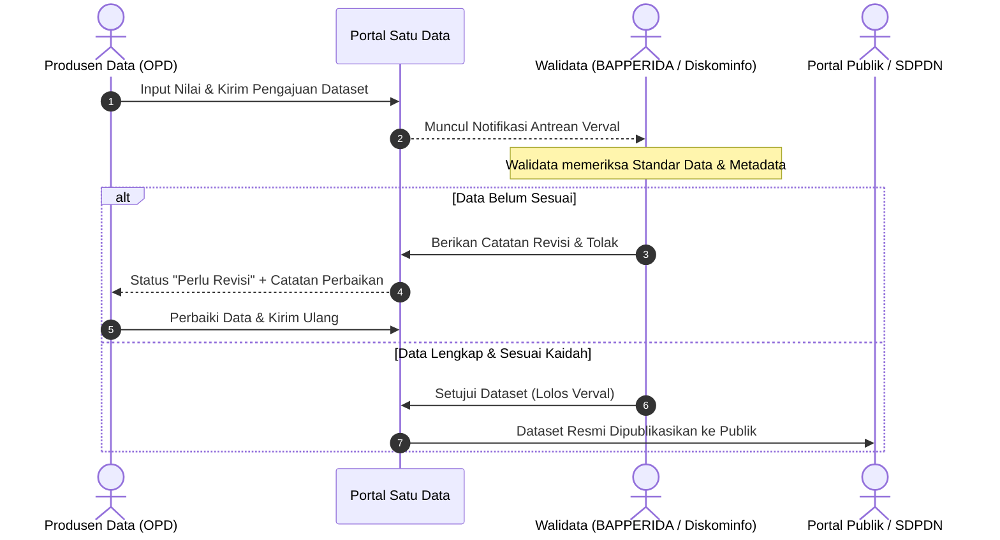

# PANDUAN PENGGUNA PORTAL SATU DATA INDONESIA (SDI)
**KABUPATEN SUMBA BARAT**

> Dokumen Panduan Operasional Khusus: **Pilar 2 — Portal Satu Data Daerah & Bank Data Sektoral**  
> Sistem: `peta-ekonomi` / Modul Satu Data Kab. Sumba Barat  
> URL Produksi: [https://arsipdigital.mindcloud.my.id/#dashboard](https://arsipdigital.mindcloud.my.id/#dashboard)  
> Pemutakhiran Terakhir: November 2026

---

## Daftar Isi

1. [Prinsip Satu Data Indonesia (SDI) & Ekosistem Daerah](#1-prinsip-satu-data-indonesia-sdi)
2. [Peran & Wewenang (Role Management)](#2-peran--wewenang)
3. [Dashboard Satu Data](#3-dashboard-satu-data)
4. [Bank Data: Pengelolaan Dataset Sektoral](#4-bank-data-pengelolaan-dataset-sektoral)
5. [Bank Data: Indikator Kinerja (IKU, IKD, IKK)](#5-bank-data-indikator-kinerja)
6. [Alur Verifikasi & Validasi (Verval) Walidata](#6-alur-verifikasi--validasi-verval-walidata)
7. [Modul Pemantauan Capaian SPM (Standar Pelayanan Minimal)](#7-modul-pemantauan-capaian-spm)
8. [Master Satu Data (Konfigurasi Fondasi SDI)](#8-master-satu-data)
9. [Kelola Konten & Publikasi Informasi](#9-kelola-konten--publikasi-informasi)
10. [Monitoring Sistem & Integrasi Nasional (SDPDN)](#10-monitoring-sistem--integrasi-nasional-sdpdn)
11. [Dokumentasi API & Query Builder](#11-dokumentasi-api--query-builder)
12. [Portal Publik Terbuka & Keterbukaan Informasi](#12-portal-publik-terbuka)

---

## 1. Prinsip Satu Data Indonesia (SDI)

Sesuai amanat **Peraturan Presiden Nomor 39 Tahun 2019 tentang Satu Data Indonesia**, Portal Satu Data Kabupaten Sumba Barat dirancang untuk mewujudkan keterpaduan perencanaan, pelaksanaan, evaluasi, dan pengendalian pembangunan melalui ketersediaan data yang akurat, mutakhir, terpadu, dapat dipertanggungjawabkan, serta mudah diakses.

### 4 Prinsip Dasar Data SDI:
1. **Memenuhi Standar Data**: Memiliki konsep, definisi, cakupan, klasifikasi, ukuran, dan satuan yang baku.
2. **Memiliki Metadata**: Informasi terstruktur yang mendeskripsikan konteks, metodologi pengumpulan, dan validitas data.
3. **Memenuhi Interoperabilitas Data**: Menggunakan format terbuka (`CSV`, `JSON`, `API`) yang dapat dibaca antar-sistem elektronik secara otomatis.
4. **Menggunakan Kode Referensi / Data Induk**: Terikat dengan kode referensi nasional (seperti kode wilayah Kemendagri, NIK, NIP).

---

## 2. Peran & Wewenang

Dalam ekosistem Satu Data Kabupaten Sumba Barat, pembagian peran dibagi menjadi:

| Role | Tanggung Jawab Utama | Akses Menu Kunci |
|---|---|---|
| **Admin SDI** | Konfigurasi master data, manajemen pengguna OPD, monitoring integrasi SDPDN, kelola berita/konten, dan pemeliharaan website. | Seluruh menu Satu Data & Administrasi |
| **Walidata Daerah** | Verifikasi kepatuhan dataset, review metadata, persetujuan publikasi data (Verval), dan komunikasi perbaikan data ke OPD. | Dashboard SDI, Bank Data (Dataset, Indikator, Verifikasi), Capaian SPM, Monitoring |
| **Produsen Data (Operator OPD)** | Melakukan penginputan angka realisasi per tahun/wilayah, melengkapi isian metadata, dan merespon catatan perbaikan data. | Dashboard SDI, Bank Data (Dataset & Indikator OPD bersangkutan), SPM OPD terkait |
| **Publik / Tamu** | Menjelajahi katalog data terbuka, membaca visualisasi grafik, dan mengunduh data sektoral secara bebas. | Halaman Portal Publik (`#publik`) |

---

## 3. Dashboard Satu Data

Akses menu **Satu Data → Dashboard Satu Data** (`#dashboard` pada mode Satu Data):
- **Statistik Dataset**: Total dataset aktif, dataset terverifikasi, dataset menunggu verval, dan dataset draf.
- **Tingkat Kepatuhan Produsen Data**: Rekapitulasi keaktifan 30+ OPD Kabupaten Sumba Barat dalam memperbarui data berkala.
- **Sebaran Dataset per Bidang Urusan**: Visualisasi interaktif komposisi data (Pendidikan, Kesehatan, Pertanian, Pariwisata, Pekerjaan Umum, dll).
- **Log Pemutakhiran Terkini**: Daftar pembaruan data terbaru yang masuk dari operator OPD.

---

## 4. Bank Data: Pengelolaan Dataset Sektoral

Akses menu **Satu Data → Bank Data → Dataset Satu Data** (`#bankdata` tab `dataset`):

### A. Menambahkan Dataset Baru (Produsen Data / Walidata)
1. Klik tombol **Tambah Dataset**.
2. Lengkapi formulir standar SDI:
   - **Judul Dataset**: Gunakan nama yang lugas dan terstandar (contoh: *Jumlah Produksi Padi Sawah menurut Kecamatan di Kabupaten Sumba Barat*).
   - **Urusan & Bidang Urusan**: Tentukan klasifikasi urusan pemerintahan.
   - **Topik & Sub-Topik**: Kategorisasi tema (contoh: *Pangan & Pertanian*).
   - **Produsen Data (OPD)**: Unit kerja penghasil data resmi.
   - **Periode Pemutakhiran**: Tahunan, Semesteran, Triwulanan, atau Bulanan.
   - **Satuan**: Pilih satuan baku (Ton, Ha, Jiwa, Persen, Rp, dll).
3. **Struktur Data Tabular**:
   - Tentukan dimensi data (misal: kolom Wilayah Kecamatan, baris Tahun Anggaran).
   - Masukkan nilai angka realisasi pada tabel grid interaktif.
4. **Kelengkapan Metadata**:
   - Definisi operasional, metodologi perhitungan, formula, dan sumber perolehan data.
5. Klik **Simpan Draf** atau **Kirim untuk Verifikasi**.

### B. Unggah Massal & Ekspor
- Tersedia tombol **Unduh Template Excel** untuk pengisian data *offline*.
- Fitur **Import Excel/CSV** untuk memuat ratusan baris data sekaligus dalam hitungan detik.

---

## 5. Bank Data: Indikator Kinerja

Akses menu **Satu Data → Bank Data → Indikator Kinerja** (`#bankdata` tab `kinerja`):
- Mengelola indikator capaian pembangunan strategis:
  * **IKU (Indikator Kinerja Utama)**: Indikator makro tingkat kabupaten (Pertumbuhan Ekonomi, IPM, Angka Kemiskinan, Gini Ratio).
  * **IKD (Indikator Kinerja Daerah)**: Indikator tingkat bidang urusan.
  * **IKK (Indikator Kinerja Kunci)**: Indikator operasional OPD sesuai dokumen RPJMD & Renstra.
- Menampilkan perbandingan **Target vs Realisasi** per tahun, persentase capaian kinerja, serta grafik tren multi-tahun.

---

## 6. Alur Verifikasi & Validasi (Verval) Walidata

Akses menu **Satu Data → Bank Data → Verifikasi Dataset** (`#bankdata` tab `verifikasi`):

---

## 7. Modul Pemantauan Capaian SPM

Menu **Satu Data → Capaian SPM** (`#spm`) mengawal pemenuhan hak dasar warga negara:

### 6 Urusan Wajib Pelayanan Dasar yang Dipantau:
1. **Pendidikan**: Akses pendidikan dasar (PAUD, SD, SMP).
2. **Kesehatan**: Pelayanan kesehatan ibu, bayi, balita, usia produktif, lansia, dan penyakit menular.
3. **Pekerjaan Umum**: Akses air minum layak dan sanitasi dasar.
4. **Perumahan Rakyat**: Penyediaan dan rehabilitasi rumah layak huni bagi korban bencana/relokasi.
5. **Trantibumlinmas**: Pelayanan ketenteraman umum, perlindungan masyarakat, dan evakuasi bencana.
6. **Sosial**: Rehabilitasi sosial bagi penyandang disabilitas terlantar, anak terlantar, dan lansia terlantar.

### Sub-menu SPM:
- **Dashboard SPM**: Visualisasi capaian persentase target SPM per triwulan dan tahun berjalan.
- **Capaian per Bidang**: Rincian sub-indikator teknis per OPD pengampu.
- **Matriks & Referensi**: Standar batas minimal dan dasar hukum regulasi teknis kementerian.
- **Dokumen Pendukung**: Pengunggahan berkas bukti dukung (SK Tim SPM, Dokumen Anggaran, Laporan Evaluasi Triwulanan).

---

## 8. Master Satu Data

Menu **Satu Data → Master Satu Data** (`#master-satudata`) *(Khusus Administrator)*:
1. **Pengaturan OPD**: Master data unit kerja produsen data, kode instansi, dan kontak person.
2. **Urusan & Bidang Urusan**: Kodifikasi urusan pemerintahan mengacu pada regulasi Kemendagri (Permendagri 90/2019).
3. **Hak Akses Urusan**: Pemetaan hak akses pengisian dataset terhadap urusan tertentu per akun OPD.
4. **Topik & Sub-Topik**: Taksonomi tematik untuk pengelompokan katalog data di portal publik.
5. **Satuan Baku**: Standarisasi penulisan satuan ukuran statistik agar konsisten.
6. **Daftar Data (SK Bupati)**: Inventarisasi dataset prioritas daerah yang telah ditetapkan melalui Keputusan Bupati Sumba Barat.
7. **Template Field**: Standarisasi skema kolom untuk jenis dataset tertentu.
8. **Master Wilayah**: Kodifikasi wilayah administrasi (Kecamatan dan Kelurahan/Desa se-Kabupaten Sumba Barat).
9. **Permintaan Reopen**: Fasilitas persetujuan bagi OPD yang mengajukan pembukaan kembali data tahun lampau yang telah dikunci/final.

---

## 9. Kelola Konten & Publikasi Informasi

Menu **Satu Data → Kelola Konten** (`#kelola-konten`) *(Khusus Administrator)*:
- **Berita & Artikel**: Publikasi artikel analisis statistik, rilis data berkala BAPPERIDA, dan kabar pembangunan ekonomi daerah.
- **Publikasi, SK & Produk Hukum**: Repositori unduhan buku publikasi (*Sumba Barat dalam Angka*, PDRB, Profil Daerah) serta produk hukum SK Satu Data.
- **Video & Portal Eksternal**: Tautan integrasi ke portal kementerian (Bappenas, BPS, Satu Data Indonesia Nasional, dsb).
- **Changelog Aplikasi**: Catatan rilis pembaruan fitur sistem untuk transparansi pengguna.

---

## 10. Monitoring Sistem & Integrasi Nasional (SDPDN)

Menu **Satu Data → Monitoring Sistem** (`#monitoring`) *(Khusus Administrator)*:
1. **Token API SDPDN**: Pengelolaan kredensial token interoperabilitas dengan sistem **Satu Data Pembangunan Daerah Nasional (Kemendagri / Bappenas)**.
2. **Kesehatan & Scheduler**: Pemantauan status server, database PostgreSQL, kapasitas storage Google Drive, dan antrean worker background.
3. **Data Pengunjung & Kunjungan Halaman**: Analisis statistik trafik pengunjung publik untuk mengetahui dataset yang paling diminati.
4. **Log Aktivitas & Metrik**: Pemantauan rekam jejak pengisian data oleh seluruh operator OPD.
5. **Pertanyaan Q&A & FAQ**: Pengelolaan pertanyaan dan permintaan data dari masyarakat.
6. **Query Builder & Ekspor**: Pembangun kueri SQL visual untuk kebutuhan penarikan laporan kustom.

---

## 11. Dokumentasi API & Query Builder

Akses menu **Satu Data → Dokumentasi API** (`#dokumentasi-api`):
- Menyediakan endpoint REST API terstandarisasi untuk integrasi antar-aplikasi pemerintah:
  * `GET /api/satudata/dataset` : Menampilkan katalog dataset terpublikasi.
  * `GET /api/satudata/dataset/:id` : Menampilkan isi tabular dan metadata dataset.
  * `GET /api/satudata/indikator` : Menampilkan data indikator kinerja makro daerah.
  * `GET /api/satudata/spm` : Menampilkan capaian SPM terkini.
- Format respon data menggunakan standar `JSON` dengan paginasi dan filter parameter.

---

## 12. Portal Publik Terbuka

Akses menu **Satu Data → Portal Publik** (`#publik`):
- Halaman etalase publik yang dapat diakses oleh seluruh lapisan masyarakat tanpa perlu melakukan autentikasi / login.
- Menyediakan:
  * Pencarian instan dataset sektoral.
  * Grafik visual interaktif yang responsif pada desktop maupun smartphone.
  * Peta tematik sebaran data per kecamatan di Sumba Barat.
  * Tombol unduh data terbuka dalam format `CSV`, `Excel`, dan `PDF`.

