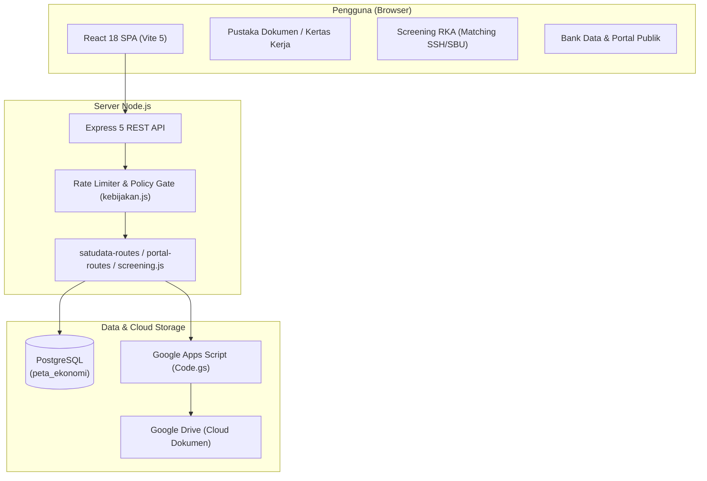
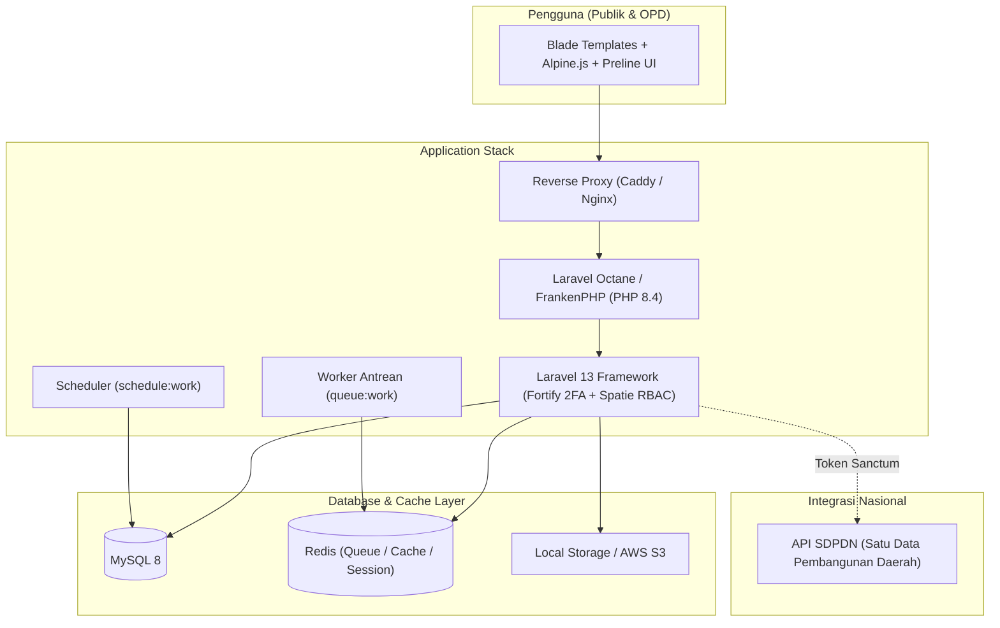

# Dokumen Komparasi Sistem: Peta Ekonomi vs Satu Data Kabkota

> **Tanggal Analisis**: November 2026  
> **Objek Komparasi**:
> 1. `D:\Code\peta-ekonomi` (Arsip Digital BAPPERIDA & Bank Data Sumba Barat)
> 2. `D:\Code\satudata-kabkota-v2026.10.27` (Portal Satu Data Kabupaten/Kota - Rilis Distribusi Standar SASANDO / SKALA)

---

## 1. Ringkasan Eksekutif

| Parameter | [peta-ekonomi](file:///D:/Code/peta-ekonomi) | [satudata-kabkota-v2026.10.27](file:///D:/Code/satudata-kabkota-v2026.10.27) |
|---|---|---|
| **Fokus & Ranah Sistem** | **Sistem Kerja Operasional Internal BAPPERIDA Sumba Barat** (Arsip Perencanaan, Screening RKA/SSH/SBU SIPD, Kertas Kerja, & modul Bank Data Satu Data terintegrasi). | **Portal Resmi Satu Data Indonesia (SDI) Tingkat Kabupaten/Kota** (Portal publik terbuka, katalog dataset sektoral, verval walidata, replikasi ke SDPDN nasional). |
| **Arsitektur Utama** | **SPA Modern (Single Page Application)**: React 18 + Vite 5 + Tailwind CSS + Node.js Express 5 REST API. | **Monolit Full-Stack Enterprise**: Laravel 13 (PHP 8.4) + Blade Templates + Alpine.js + Tailwind CSS 4 + Laravel Octane (FrankenPHP). |
| **Database & Cache** | PostgreSQL (`pg`), koneksi pool langsung, query in-memory, integrasi Google Drive via Apps Script. | MySQL 8 (25 migration Eloquent) + Redis (Cache, Session, & Queue Worker). |
| **Penyimpanan Berkas** | Google Drive via Google Apps Script (`Code.gs`) dengan validasi *magic bytes*. | Penyimpanan server lokal / S3 via Flysystem, komponen upload FilePond. |
| **Status Repositori** | Repositori Git aktif (`hudsonjhonson9-arch/peta-ekonomi`), commit berlanjut secara intensif. | Paket rilis rujukan (`v2026.10.27`, commit `35c772e`), format distribusi siap pasang (ZIP / Docker). |
| **Skala Baris Kode** | ~28.150 baris React/JSX + ~9.875 baris Express JS + ~2.160 baris SQL. | ~34.500 baris PHP backend + ~46.620 baris Blade + ~3.245 baris JS + ~1.560 baris migration. |

---

## 2. Diagram Arsitektur & Alur Kerja

### A. Arsitektur peta-ekonomi (Workstation Internal & SPA)

### B. Arsitektur satudata-kabkota-v2026.10.27 (Enterprise SDI Portal)

---

## 3. Matriks Komparasi Modul & Fitur

### A. Modul Fungsional yang Sama (Adopsi / Irisan)

`peta-ekonomi` telah mengadopsi struktur fungsional 11 bab standar dari `satudata-kabkota` (diverifikasi melalui `satudata-gap.uji.mjs`):

| Fitur | [peta-ekonomi](file:///D:/Code/peta-ekonomi) | [satudata-kabkota](file:///D:/Code/satudata-kabkota-v2026.10.27) | Catatan Komparasi |
|---|---|---|---|
| **Portal Publik** | `src/components/PortalPublikLengkap.jsx`, `server/portal-routes.js` | `routes/public.php`, controller public, view blade | Menampilkan katalog dataset sektoral, indikator, visualisasi grafik interaktif, peta kecamatan, serta pencarian instan. |
| **Bank Data / Dataset Sektoral** | `src/components/BankDataPage.jsx`, `server/bank-dataset.js` | `app/Http/Controllers/Admin/Data/DataSektoralController.php` | Penginputan data per produsen OPD, verifikasi/verval oleh Walidata, siklus pemutakhiran berkala, pelacakan target SK. |
| **Master Data SDI** | `src/components/MasterSatuData.jsx`, `server/satudata-routes.js` | Controller master data: `Urusan`, `BidangUrusan`, `Topik`, `Satuan`, `ListOpd` | Struktur master data standar SDI: Urusan, Bidang Urusan, OPD, Topik/Subtopik, Satuan pengukuran. |
| **Standar Pelayanan Minimal (SPM)** | `src/components/SpmPage.jsx`, endpoint SPM di `satudata-routes.js` | `app/Http/Controllers/Admin/Spm/SpmCapaianController.php` | Pengelolaan data capaian SPM (Pendidikan, Kesehatan, PU, Perkim, Trantibumlinmas, Sosial) beserta dokumen pendukung. |
| **Pengaturan Website / CMS** | `src/components/PengaturanWebsitePage.jsx`, `server/pengaturan-situs-routes.js` | `app/Http/Controllers/Admin/SiteSettings/SiteSettingsController.php` | Kustomisasi identitas daerah, logo, lambang, hero banner, tema warna kontras tinggi, SEO, dan PWA WebManifest. |
| **Kelola Konten & Media** | `src/components/KelolaKonten.jsx`, `server/portal-konten-routes.js` | Controller `NewsController`, `KajianController`, `ProdukHukumController`, `VideoController` | Publikasi berita daerah, publikasi hasil kajian/riset, produk hukum, video YouTube edukatif daerah. |
| **Pusat Tanya Data (QnA & FAQ)** | `src/components/MonitoringPage.jsx` | `app/Http/Controllers/Public/Qna/QnaController.php`, `FaqController.php` | Form pengajuan permohonan data publik, verifikasi permohonan, dan katalog tanya-jawab umum (FAQ). |
| **Manajemen Hak Akses (RBAC)** | `src/components/KelolaRolePage.jsx`, `server/admin-lanjutan-routes.js` | `app/Http/Controllers/Admin/User/RolesController.php` (Spatie) | Pengelolaan peran bertingkat: Superadmin, Walidata, Produsen Data / Operator OPD, Reviewer, dan Publik. |

---

### B. Fitur Eksklusif yang Hanya Ada di `peta-ekonomi`

Fitur-fitur ini tidak ditemukan di `satudata-kabkota-v2026.10.27` karena dirancang khusus untuk operasional BAPPERIDA Sumba Barat:

1. **Screening RKA (Pencocokan Standar Harga SSH & SBU SIPD 2027)**
   * **File**: `src/components/ScreeningRKA.jsx`, `server/screening.js`, `server/standar-harga.js`
   * **Fungsi**: Membantu verifikator BAPPERIDA menelaah draft rincian belanja subkegiatan RKA OPD, mencocokkan otomatis *top-5* standar harga satuan berdasarkan kode rekening SIPD, menghitung selisih harga pagu vs standar SSH/SBU, dan mengimpor file master SSH/SBU Excel.
2. **Kertas Kerja Digital Perencanaan**
   * **File**: `src/components/KertasKerja.jsx`, `server/tautan-periode.js`
   * **Fungsi**: Visualisasi pohon kerja hierarkis (Program $\rightarrow$ Kegiatan $\rightarrow$ Subkegiatan $\rightarrow$ Output) dan pemetaan tautan pemenuhan target dokumen per periode (bulanan/triwulanan).
3. **Arsip Digital Dokumen & Alur Persetujuan Bertingkat (Multi-Tier Approval)**
   * **File**: `server/index.js`, `README.md`
   * **Alur**: `Staf Upload` $\rightarrow$ `Menunggu Review Kabid` $\rightarrow$ `Menunggu Persetujuan Kepala Badan` $\rightarrow$ `Disetujui & Diarsipkan` / `Ditolak dengan Catatan Revisi`.
4. **Pustaka Berkas Bergaya File Explorer / Finder**
   * **File**: `src/components/PustakaBerkas.jsx`
   * **Fungsi**: Tampilan file modern dengan drawer *drag-to-resize*, preview dokumen PDF/JPG langsung dari Google Drive, dan filter dinamis multi-kategori.
5. **Integrasi Google Drive & Apps Script (GAS)**
   * **File**: `google-apps-script/Code.gs`, `server/validasi-file.js`
   * **Fungsi**: Unggah dokumen tanpa membebani penyimpanan server lokal, lengkap dengan verifikasi *magic bytes* header biner file untuk keamanan.
6. **Modul Pengelolaan Perjanjian Kerja Sama (PKS)**
   * **File**: `src/components/PksAdmin.jsx`, `src/components/PksRingkasan.jsx`
   * **Fungsi**: Pencatatan dan monitoring masa berlaku kemitraan kerja sama daerah.

---

### C. Fitur Eksklusif yang Hanya Ada di `satudata-kabkota-v2026.10.27`

Fitur-fitur ini spesifik standar kepatuhan nasional Satu Data Indonesia:

1. **Integrasi Nasional SDPDN (Satu Data Pembangunan Daerah)**
   * **File**: `routes/api.php`, `app/Http/Controllers/Api/Integration/SdpdnDatasetController.php`
   * **Fungsi**: Endpoint API terbuka terotentikasi token Sanctum (`abilities:dataset:read`) untuk sinkronisasi otomatis dataset terbuka ke portal SDI nasional.
2. **Dokumentasi API Terintegrasi (Swagger / OpenAPI)**
   * **File**: `composer.json` (`darkaonline/l5-swagger`)
   * **Fungsi**: Dokumentasi interaktif `/api/documentation` yang memudahkan integrasi dengan aplikasi pihak ketiga.
3. **Two-Factor Authentication (2FA TOTP)**
   * **File**: `app/Http/Controllers/Auth/TwoFactorSetupController.php`, Laravel Fortify
   * **Fungsi**: Autentikasi lapis kedua menggunakan QR Code dan Google Authenticator / aplikasi TOTP bagi pejabat walidata dan admin.
4. **Antrean Latar Belakang & Penjadwal Otomatis (Redis Worker & Cron)**
   * **File**: `routes/console.php`, `app/Services/FieldDefinition/PemutakhiranScheduleService.php`
   * **Fungsi**: Pembukaan gerbang pemutakhiran terjadwal, pengiriman email notifikasi/reminder harian otomatis ke OPD, pengecekan *health-check* sistem berkala per 5 menit, pembersihan token kadaluwarsa, dan auto-generate sitemap XML.
5. **Infrastruktur Multi-Tenant Kabupaten & DevOps Siap Rilis**
   * **File**: `config/portal.php`, `Dockerfile`, `compose.yml`, `Caddyfile`, `scripts/backup-database.sh`
   * **Fungsi**: Kemampuan mengganti identitas daerah hanya dengan mengubah file `.env` (`PORTAL_NAMA_DAERAH`, `KODE_WILAYAH`, `PORTAL_LAMBANG`), dilengkapi skrip automasi backup/restore MySQL dan container FrankenPHP Octane siap produksi.
6. **Buku Panduan Operasional Terstruktur (11 Bab PDF/Markdown)**
   * **File**: `docs/manual/`
   * **Fungsi**: Dokumentasi visual terperinci langkah demi langkah untuk setiap peran (Superadmin, Walidata, Produsen Data OPD, dan Publik).

---

## 4. Analisis Keamanan & Performa

| Aspek | [peta-ekonomi](file:///D:/Code/peta-ekonomi) | [satudata-kabkota-v2026.10.27](file:///D:/Code/satudata-kabkota-v2026.10.27) |
|---|---|---|
| **Autentikasi** | Session cookie dengan NIP + password hash bcrypt (`user_credentials`). | Email/Username + Password bcrypt + 2FA TOTP (Laravel Fortify). |
| **Otorisasi / Akses** | Middleware sentral `kebijakan.js` berbasis pemetaan URL regex ke level hak (`PUBLIK`, `LOGIN`, `BANKDATA`, `REVIEW`, `ADMIN`). | Matriks granular peran dan permission via `spatie/laravel-permission` yang disimpan di database. |
| **Proteksi Serangan** | Pembatas laju request kustom (`rate-limit.js`), validasi tipe file biner *magic bytes*. | Middleware bawaan Laravel: CSRF Token, SQL Injection protection via PDO/Eloquent, XSS HTML Sanitizer, rate limit Redis. |
| **Performa Klien** | **Sangat Cepat**: Rendering di browser (React Virtual DOM), navigasi tanpa muat ulang halaman, filter tabel instan. | Berbasis Server-Side Rendering (Blade) + Alpine.js. Responsif, namun membutuhkan transfer HTML per pergantian halaman. |
| **Performa Server** | Ringan, berbasis *event-loop* Node.js non-blocking, query PostgreSQL langsung tanpa overhead ORM berat. | Berkecepatan tinggi berkat Laravel Octane (FrankenPHP) yang menjaga *application state* di RAM, didukung Redis caching. |

---

## 5. Hubungan Strategis & Rekomendasi Pemanfaatan

### Mengapa modul Satu Data ada di dalam `peta-ekonomi`?
Pengembangan terbaru pada repositori `peta-ekonomi` membuktikan bahwa tim pengembang secara sengaja mengadaptasi dan memporting seluruh fitur portal Satu Data (Portal Publik, Bank Data Sektoral, SPM, dan CMS Pengaturan) ke dalam ekosistem React + Express. Tujuannya adalah menghadirkan sistem terpadu (*one-stop workstation*) bagi BAPPERIDA Sumba Barat sehingga aparatur tidak perlu berpindah aplikasi antara urusan telaah dokumen perencanaan dan pengelolaan data indikator pembangunan.

### Rekomendasi Skenario Implementasi

1. **Skenario 1: Sinergi Dua Sistem (Rekomendasi Utama)**
   * **Workstation Internal**: Gunakan **`peta-ekonomi`** sebagai sistem dapur kerja internal BAPPERIDA untuk menelaah RKA, menyusun kertas kerja, mengarsipkan dokumen perencanaan, dan memvalidasi awal angka indikator sektoral.
   * **Portal Eksternal Resmi Pemda**: Gunakan **`satudata-kabkota-v2026.10.27`** sebagai portal induk resmi Satu Data Kabupaten Sumba Barat di tingkat Diskominfo/Pemda yang terhubung langsung ke SDPDN Nasional.
   * **Integrasi**: Tarik data indikator yang telah final dan disetujui di `peta-ekonomi` untuk disinkronkan ke `satudata-kabkota` melalui REST API.

2. **Skenario 2: Penerapan Mandiri `peta-ekonomi` (Jika Sumber Daya Terbatas)**
   * Jika Pemda menginginkan sistem yang praktis, hemat sumber daya server, dan mencakup semua kebutuhan BAPPERIDA dalam satu aplikasi tunggal, **`peta-ekonomi`** siap digunakan mandiri karena telah memiliki Portal Publik yang responsif dan Bank Data yang lengkap.

3. **Skenario 3: Penerapan Mandiri `satudata-kabkota` (Untuk Mandat Diskominfo)**
   * Jika mandat yang diminta semata-mata adalah kepatuhan regulasi Satu Data Indonesia tingkat Kabupaten/Kota dengan dukungan 2FA, antrean otomatis, dan integrasi SDPDN, gunakan paket **`satudata-kabkota-v2026.10.27`**.

